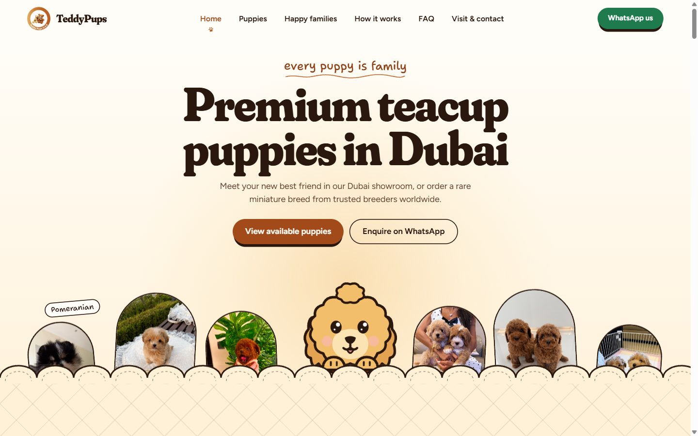
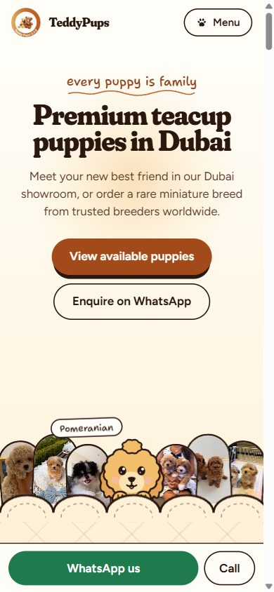

# TeddyPups clone

A clone of [puppy.instabizweb.com](https://puppy.instabizweb.com/), built with React, TypeScript and Vite for the Insta Biz Web technical assignment.

- **Live site:** https://warm-cucurucho-edd5f0.netlify.app/
- **Reference:** https://puppy.instabizweb.com/

| Desktop (1440px)                               | Mobile (390px)                               |
| ---------------------------------------------- | -------------------------------------------- |
|  |  |

## What is in it

Seven main pages, 42 puppy profile pages and a 404 page (50 routes in total):

| Route             | What it has                                                                                                       |
| ----------------- | ----------------------------------------------------------------------------------------------------------------- |
| `/`               | Hero with rotating puppy line-up, pinned door showcase, chat story, family photo wall, FAQ teaser, walking mascot |
| `/puppies`        | Filterable catalogue (origin, breed, gender) with the filters stored in the URL                                   |
| `/puppies/:slug`  | Photo and video gallery, full-screen viewer, enquiry form, reading-progress ribbon                                |
| `/happy-families` | 64-photo wall with a full-screen viewer                                                                           |
| `/how-it-works`   | Tabbed "two ways home" journeys, scroll-driven flight path                                                        |
| `/faq`            | Searchable notice board of questions                                                                              |
| `/contact`        | Fill-in-the-blanks letter form with a posting animation                                                           |
| `/gone-home`      | Puppies that have already been rehomed                                                                            |

Shared across pages: sticky header that hides on scroll down, mobile menu, page-transition blanket, smooth wheel scrolling, cursor paw trail, footer, and a WhatsApp / Call bar on mobile.

## Tech stack

| Piece                 | Why                                                                                                                              |
| --------------------- | -------------------------------------------------------------------------------------------------------------------------------- |
| **React 19**          | Component model for the stateful parts (filters, galleries, forms) while most of each page stays static markup.                  |
| **TypeScript**        | Strict types for the data (puppies, media, FAQs) and component props; `tsc` runs as part of every build.                         |
| **Vite 7**            | Fast dev server, and it code-splits each page template into its own chunk with one `import.meta.glob` call.                      |
| **Motion**            | The reference uses it. Using the same springs, layout animations and frame loop was the only reliable way to match its movement. |
| **Lenis**             | The reference's smooth-scroll library; same settings (`lerp: 0.1`, `wheelMultiplier: 0.85`).                                     |
| **html-react-parser** | Turns the saved page markup into React elements and lets me swap individual elements for live components.                        |
| **Prettier**          | One formatting style across the codebase (`npm run format`).                                                                     |
| **Netlify**           | Static hosting with Git-based deploys, SPA redirects and an image CDN.                                                           |

There is no CSS framework dependency. `src/reference.css` is the reference site's compiled stylesheet (it was built with Tailwind), used as-is so spacing, colours and breakpoints are identical.

## How it is built

The reference is a server-rendered Next.js site. I do not have its source, so the clone is put together from three layers:

1. **Captured markup and styles.** Each page's rendered HTML is saved in `src/templates/`, and the compiled stylesheet in `src/reference.css`. This guarantees the layout matches at every breakpoint.
2. **A React layer I wrote** (`src/`, about 3,200 lines of TypeScript). It renders the templates, replaces the interactive parts with real components, and handles routing, transitions, scrolling, forms and metadata.
3. **The mascot's animation engine**, `src/motion/reference-motion.js`. This is the reference's own compiled puppy code (pose maths, walk cycle, eye and ear physics), kept verbatim with a small module loader around it. Everything that _drives_ it (`PupBuddy.tsx`, the scroll state it reads) is mine.

`src/Template.tsx` is the join between layers 1 and 2: it walks a template and asks a "slot" function about each element, which can return a component to render in its place.

## Folder structure

```
.
├── index.html               Entry HTML: meta tags, font preloads, first-paint cover
├── netlify.toml             Build command, SPA redirect, cache headers, image CDN switch
├── vite.config.ts
├── docs/                    README screenshots
├── public/
│   ├── media/               Puppy and family photos, videos, posters
│   ├── brand/, cursor/      Logo and custom cursor
│   └── _next/static/media/  Web fonts (path kept so the stylesheet's @font-face URLs resolve)
└── src/
    ├── main.tsx             Mounts the app into <body>
    ├── App.tsx              Shell + current page; scroll reset; link handling
    ├── Template.tsx         HTML template → React elements, with component slots
    ├── reference.css        Compiled stylesheet from the reference
    ├── types.ts             Media, Puppy, Faq …
    ├── shell/               Things present on every page
    │   ├── Shell.tsx            Header, nav, mobile menu, footer
    │   ├── RouteCurtain.tsx     Page-transition blanket state machine
    │   ├── SmoothScroll.tsx     Lenis setup and in-page anchor links
    │   ├── useHeaderBehavior.ts Hide on scroll down, show on scroll up
    │   └── PawTrail.tsx         Canvas paw prints behind the cursor
    ├── pages/
    │   ├── Page.tsx             Picks the template for a route and fills its slots
    │   └── NotFound.tsx         404 poster
    ├── home/                Homepage-only pieces
    │   ├── HeroLineup.tsx       Puppies ducking and popping up behind the quilt
    │   ├── MeetShowcase.tsx     Pinned, horizontally scrolling doors
    │   └── ChatStory.tsx        Scroll-stepped WhatsApp conversation
    ├── components/          Reusable interactive components
    │   ├── PuppyBrowser.tsx     Catalogue filters
    │   ├── PuppyGallery.tsx     Profile gallery
    │   ├── PhotoViewer.tsx      Full-screen photo viewer
    │   ├── NoticeBoard.tsx      FAQ board with search
    │   ├── EnquiryForm.tsx      Profile enquiry form
    │   ├── LetterForm.tsx       Contact letter form
    │   ├── JourneyTabs.tsx      How-it-works tabs
    │   ├── PupBuddy.tsx         The mascot's behaviour
    │   └── MediaImage.tsx       Photo with blur-up placeholder
    ├── lib/                 Non-visual helpers
    │   ├── router.ts            History API router and lazy template loading
    │   ├── enquiry.ts           Form validation and submit
    │   ├── image.ts             Responsive image URLs (Netlify Image CDN)
    │   ├── useReveal.ts         Scroll-reveal
    │   ├── useScrollEffects.ts  Flight path and profile ribbon
    │   └── useDocumentMeta.ts   Per-route title, description, social tags, JSON-LD
    ├── motion/              Mascot animation engine (from the reference) and its types
    ├── templates/           Saved markup: one file per page, plus header and footer
    └── data/                JSON: puppies, family photos, FAQs, breeds, route table
```

## Run it locally

Requires Node.js 22 or newer.

```bash
git clone <repo-url>
cd <repo-folder>
npm install
npm run dev       # dev server at http://localhost:5173
```

```bash
npm run build     # type-check, then production build into dist/
npm run preview   # serve dist/ at http://localhost:4173
npm run format    # Prettier
```

No environment variables are needed. `.env.example` documents the one optional setting (see "Forms" below).

## Implementation decisions and challenges

**1. Reusing the reference's markup instead of rewriting it.**
Hand-writing 50 pages of illustrated SVG-heavy markup would have cost days and still drifted from the original. Saving the rendered HTML and rendering it through `html-react-parser` gave an exact layout quickly, and left the time for behaviour. The trade-off is that the templates are not pleasant to edit by hand, and content changes on the reference have to be re-synced.

**2. The layout matched but the behaviour did not.**
My first version looked right in screenshots, yet scrolling felt different. To find out why, I wrote a script that loads both sites in a headless browser, scrolls them with identical wheel input, and at each step compares every element's data attributes, opacity, transform and position. It surfaced what screenshots hid: no smooth scrolling, a header that never hid, a chat section that showed everything at once, different reveal timing, and the walking puppy mounted in the wrong part of the DOM. I then rewrote each interactive piece to follow the reference's logic. After the rewrite the same script reports no differences beyond in-flight animations (see [TESTING.md](TESTING.md)).

**3. Smooth scrolling and animation had to share a frame.**
The puppy, the pinned door track and the scroll position all update every frame. Running them on separate `requestAnimationFrame` loops made the puppy lag a frame behind the page. The fix was to use Motion's frame scheduler for everything: Lenis advances in the `read` step, then the springs and the puppy run in `update`.

**4. Rendering into `<body>`.**
The stylesheet has selectors such as `html:has(> body > .tp-curtain[data-state=intro])`. With the usual `<div id="root">` wrapper these never matched, so the intro animation was skipped. React now mounts directly into `<body>`.

**5. A bug that silently disabled smooth scrolling.**
My metadata hook reset `<html class>` on every navigation, which wiped the classes Lenis adds to itself. Nothing errored; scrolling just stopped being smooth. The comparison script caught it because scroll positions stopped matching the reference.

**6. Forms without a backend.**
The reference posts enquiries to a private server action. The clone validates in the browser with the same rules and error messages, plays the same success animation, and sends nothing. Setting `VITE_ENQUIRY_ENDPOINT` makes both forms POST their fields as JSON to that URL. A hidden honeypot field catches simple bots.

**7. Refreshing a page returned 404.**
A single-page app has one HTML file, so `/faq` does not exist on the server. `netlify.toml` rewrites every unknown path to `index.html`, and the app's own router shows the 404 poster for routes it does not know.

**8. Image weight.**
Next.js resizes images on the server; a static build serves the originals, which made the home page about 3.5 MB. On Netlify the app requests resized variants from Netlify Image CDN through `srcset` (`src/lib/image.ts`), using each image's original `sizes` hint. It is switched on by `VITE_IMAGE_CDN` in `netlify.toml`, so local builds still work without the CDN.

**9. Bundle size.**
All page templates were originally bundled together (2.3 MB of JavaScript). Each template is now a separate chunk loaded on first visit, and preloaded while the transition blanket is closing so navigation does not wait on the network.

**10. Accessibility kept from the original.**
Reduced-motion users get no blanket, no smooth scroll and no walking puppy, and all content is revealed immediately. Dialogs are native `<dialog>` elements, tabs follow the ARIA tab pattern, and form errors are announced and focused.

## Testing

Automated comparison against the reference, functional checks, cross-browser runs and Lighthouse results are recorded in [TESTING.md](TESTING.md).

## Deployment

Hosted on Netlify, configured by [`netlify.toml`](netlify.toml):

- Build command `npm run build`, publish directory `dist`, Node 22
- SPA fallback redirect so deep links and refreshes work
- One-year immutable caching for fingerprinted assets and fonts
- `VITE_IMAGE_CDN=netlify` to serve resized images

With the repository connected in Netlify, every push to `main` builds and deploys automatically.

## AI tools used

AI coding assistants wrote a large share of this code under my direction: capturing the reference, the first React version, and then the audit, comparison tooling and behaviour rewrite described above. The tools, what each was used for, and the exact prompts are listed in [AI_PROMPTS.md](AI_PROMPTS.md).

## Known differences from the reference

- Enquiry forms do not send anything unless an endpoint is configured.
- Puppy listings are a snapshot; there is no CMS or admin behind them.

- The mascot's animation engine is the reference's compiled code rather than a rewrite.

## Credits

Design, artwork, copy and photos belong to the owners of the reference site. This project is an assignment submission, not a commercial product.
